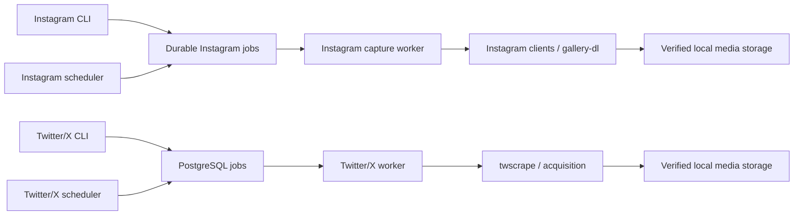

# Architecture and source provenance

Each platform is independently installable and owns its queue, scheduler,
credentials and media storage. There is no shared HTTP control plane.

The packages were extracted from the active backend implementations of
SocialMedia_autoArchive and XLoader, including subsequent queue-priority and
capture compatibility fixes. They are not blind copies of an upstream default
branch. Their provenance manifests identify the read-only source files by
repository-relative path and SHA-256:

- [Instagram provenance](../packages/instagram/PROVENANCE.json)
- [Twitter/X provenance](../packages/twitter/SOURCE-PROVENANCE.json)

Source hashes identify the extraction inputs, not the final adapted output.
Installation-specific paths, host configuration and original Git history are
excluded. New portable configuration, CLI and storage adapters are maintained in
this repository. See the package READMEs for intentional behavioral differences.

The Instagram extraction separates acquisition and scheduler operations from its
original combined backend API. It uses standalone state and local media metadata.
Twitter/X retains the existing PostgreSQL job and capture model with independent
configuration. Their databases are not interchangeable, and neither package is
a migration tool for an existing installation.

The original host's authentication, web readers, NAS catalog and backup services
are intentionally outside these package dependencies. No imported module should
need access to another application's deployment or production state. CLI help
must work without runtime credentials, and imports must not start capture work.
